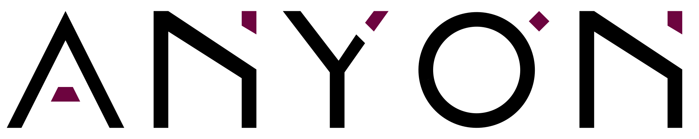

<p align="center">
  <picture>
    <source media="(prefers-color-scheme: dark)" srcset="assets/anyon-logo-white.svg">
    
  </picture>
</p>

# ▼ AXYON™ releases

**AXYON™: Built for the Next Era of Computing.**

Binary releases, the installer, user documentation and examples for the
AXYON programming language: Python-like syntax, Rust-like safety, compiled
through MLIR and LLVM.

This repository contains no compiler source. Report bugs and request features
in its [issue tracker](../../issues).

## Supported platforms

| Platform | Archive suffix | Requirements |
| --- | --- | --- |
| Linux x86_64 | `x86_64-linux-gnu` | glibc 2.28 or newer, a C toolchain for linking (`cc`) |
| Linux aarch64 | `aarch64-linux-gnu` | glibc 2.28 or newer, a C toolchain for linking (`cc`) |
| macOS on Apple silicon | `aarch64-apple-darwin` | Xcode Command Line Tools |

Each archive is self-contained: the compiler, the language server, the
prebuilt standard library and the LLVM/MLIR tools the compiler drives.

## Install

> **No release has been published yet.** The first release is in preparation; until then the install command below has nothing to download.

The installer detects your platform, downloads the matching archive,
verifies the release signature and the checksum, and installs into
`~/.axyon`. The terms of use are in [LICENSE-BINARY](LICENSE-BINARY).

```sh
curl -fsSL https://github.com/axyon-lang/axyon-releases/releases/latest/download/install.sh -o install.sh
sh install.sh
```

Signature verification needs [minisign](https://jedisct1.github.io/minisign/)
(`brew install minisign`, `sudo apt install minisign`). Without it the
installer stops. `--insecure-skip-signature` installs anyway and relies on
the checksum and HTTPS alone. We do not recommend it.

Options:

```sh
sh install.sh --version 0.1.0          # a specific release (default: latest)
sh install.sh --prefix "$HOME/.local"  # another install prefix
sh install.sh --keep-old               # keep the previous release next to the new one
sh install.sh --uninstall              # remove what the installer installed
```

Then add the prefix's `bin` directory to `PATH`, as the installer tells you,
and check the installation:

```sh
export PATH="$HOME/.axyon/bin:$PATH"
axyon --version
```

Running the installer again upgrades in place. The new release is unpacked
next to the old one, and `bin/` switches over only after the new release is
verified and unpacked.

## Manual install and verification

Every release has `axyon-<version>-<triple>.tar.gz` archives, `SHA256SUMS`
and the minisign signature `SHA256SUMS.minisig`. The release public key is
in `install.sh` (`AXYON_RELEASE_PUBKEY`) and on every release page.

```sh
minisign -Vm SHA256SUMS -P '<release public key>'
sha256sum --check --ignore-missing SHA256SUMS      # macOS: shasum -a 256 -c --ignore-missing SHA256SUMS
mkdir -p ~/.axyon && tar -xzf axyon-<version>-<triple>.tar.gz -C ~/.axyon --strip-components=1
```

An archive unpacks to a complete prefix (`bin/`, `lib/axyon/`,
`share/axyon/`). The compiler finds its standard library and tools relative to
its own location, so the prefix can be anywhere.

## Documentation and examples

- `docs/`: the user guide (also published as this repository's GitHub Pages site).
- `examples/`: example projects. Run one with `cd examples/<name> && axyon run`.

## Licence

The terms of use for the binaries are in [LICENSE-BINARY](LICENSE-BINARY);
[LICENSE](LICENSE) is the source notice. The compiler source code is
proprietary and not published. Third-party components and their notices are in
[THIRD-PARTY-NOTICES](THIRD-PARTY-NOTICES) and [LICENSES/](LICENSES/), which
every archive also carries under `share/axyon/licenses/`.

Copyright (c) 2026 by Anyon Systems Inc.
